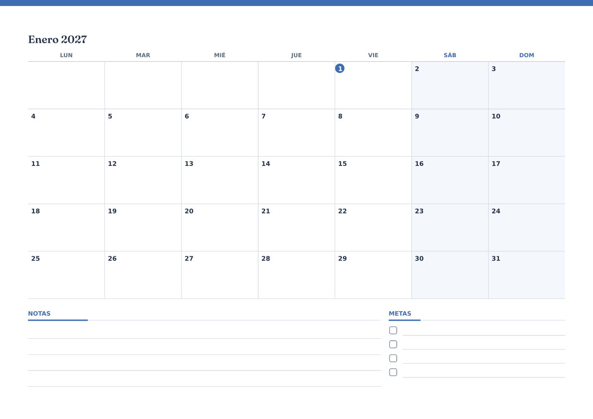
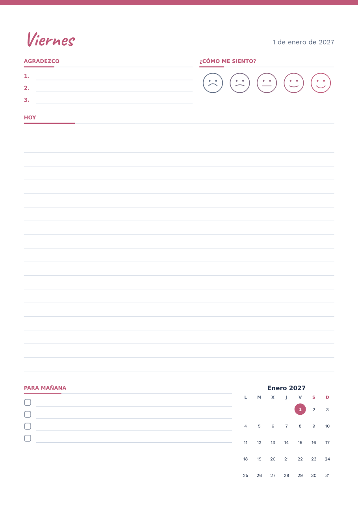
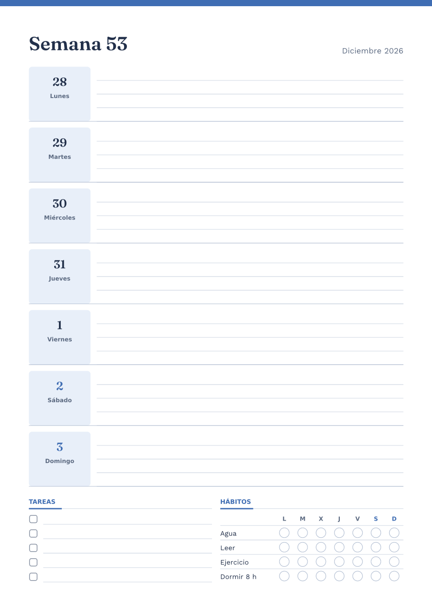
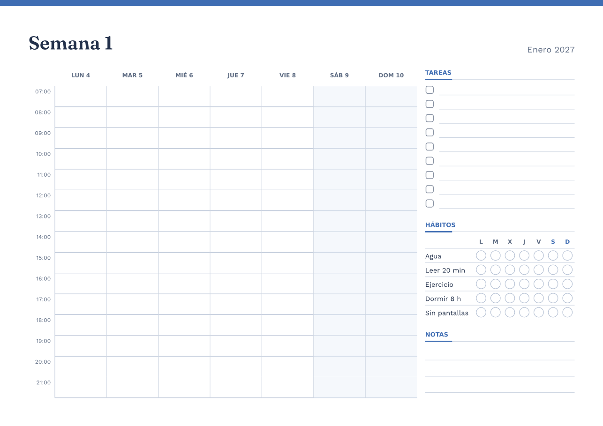

# PinDesk Plantillas

Una app aparte para **diseñar y construir plantillas por bloques** —diarios,
planificadores, calendarios, listas, notas Cornell, actas— y sacarlas a PDF,
PNG, al lienzo o a las Figuras de PinDesk. Nace dentro de este repositorio
para poder llevarla luego al suyo (ver [Separar](#separar-a-su-repositorio)).

El dueño (6-nov-2026): «diseñar y construir templates… con elementos:
encabezados, filas, columnas… jalar alguna parte y le pongo fecha, día…
calendario, diario… cualquier cosa que se me imagine… por bloques, notas,
bullet points… generar algo bueno y de forma rápida, y también que tenga
inteligencia artificial».

| Calendario mensual | Diario (una página por día) | Planificador semanal | Hecho por la IA |
|---|---|---|---|
|  |  |  |  |

Las muestras salen del núcleo sin ventana ni GPU (`tests/muestras.rs`), con
las letras de PinDesk. [`planner-semanal.pdplantilla`](plantillas/planner-semanal.pdplantilla)
es el fichero de la última.

## El nombre

«PinDesk Plantillas» es **provisional**. Está en un solo sitio en el código,
`nucleo::NOMBRE_PRODUCTO` (`crates/pindesk-plantillas/src/lib.rs`), y en el
catálogo como `plt-producto` (igual en los catorce idiomas). Lo de PinDesk
que lo nombra («Abrir en …» de Figuras) lo recibe como variable. Para
cambiarlo: esas dos cosas, el texto de los accesos del menú Inicio
(`.github/workflows/entrega.yml` y `herramientas/instalar.ps1`) y, si se
quiere, el nombre del ejecutable (`nucleo::EJECUTABLE` y el `[[bin]]` de
`apps/pindesk-plantillas/Cargo.toml`).

## Las piezas

| Carpeta | Qué es |
|---|---|
| `crates/pindesk-plantillas` | **El núcleo portable**: modelo, fechas, maquetar, editar, galería, IA, exportar y textos. Sin Windows (lo vigila el guardián de la CI), para que Android y Apple lo usen tal cual. Solo depende de `pindesk-motor2d` (Rust puro) para hablar el formato de las figuras y del lienzo de PinDesk. |
| `apps/pindesk-plantillas` | **La app de Windows** (`pindesk-plantillas.exe`, paquete `pindesk-plantillas-app`). Solo ventana: Direct2D con `pindesk-render`, `pindesk-shell`, `pindesk-ui`, `pindesk-capture` (el dispositivo), `pindesk-ia` y `pindesk-store`. **No depende de `apps/pindesk`.** |

Módulos del núcleo: `modelo` (el documento), `tema`, `fecha` y `locale` (las
fechas en catorce idiomas), `campos` (campos que se llenan solos y la
repetición), `diseno` (maquetar), `prim` (lo que sale de maquetar), `texto`
(partir y encoger textos con el medidor de quien pinta), `edicion` (insertar,
mover, deshacer, guías de soltar), `paleta` (la paleta y las propiedades),
`galeria`, `formato` (el fichero y la reparación), `ia`, `exportar` (PDF, PNG,
SVG, figura y `.excalidraw`), `carpeta` (la carpeta compartida con PinDesk),
`enlace` (línea de órdenes y enlaces) y `textos` (el catálogo Fluent).

## El documento

Todo en **milímetros** desde la esquina de arriba a la izquierda; la letra en
puntos. Un documento es una página (tamaño, orientación, márgenes), un tema,
el idioma de las fechas, una repetición opcional y **un árbol de bloques**.

### El tamaño de los bloques (flex)

Cada bloque dice cuánto ocupa **en el eje de su contenedor** (lo alto en una
columna, lo ancho en una fila) con `tam`:

- `"auto"` (lo de fábrica): lo que mide su contenido si lo sabe (una lista
  sus renglones, una tabla sus filas, un encabezado su letra); si no lo sabe
  (un área de notas, un horario), se estira como `1fr`.
- `"30mm"` (o `"3cm"`, o un número): fijo.
- `"2fr"` (o `"50%"`): una parte de lo que queda tras los fijos.

Si lo fijo no cabe, se encoge todo a la par dejando algo a lo que se estira.
En el cruce (lo ancho en una columna) cada hijo ocupa todo.

### Los bloques

| Grupo | Tipo (`"tipo"`) | Campos |
|---|---|---|
| Contenedores | `fila`, `columna` | `hijos`, `hueco` (mm) |
| | `rejilla` | `hijos`, `columnas`, `hueco` |
| | `pila` (capas: hijos superpuestos) | `hijos` |
| | `seccion` (rótulo con raya de acento) | `titulo`, `recuadro`, `hijos` |
| Texto | `encabezado` | `texto`, `nivel` 1–3, `alineacion` |
| | `texto` | `texto`, `puntos`, `alineacion` |
| | `notas` (rótulo y pauta) | `titulo`, `pauta` |
| | `lineas` (renglones, puntos, cuadrícula o nada) | `pauta` `rayado`/`puntos`/`cuadricula`/`blanco`, `paso` |
| | `divisor` | `trazo` `continuo`/`discontinuo`/`punteado`/`acento` |
| | `espacio`, `imagen` (hueco para una foto) | `etiqueta` |
| Listas | `vinetas`, `casillas`, `numerada` | `items`, `vacias` (renglones vacíos) |
| | `tabla` | `filas`, `columnas`, `cabeceras` |
| Fechas | `campo` | `campo` `fecha`/`dia`/`dia_semana`/`semana`/`mes`/`ano`/`pagina`, `formato` `corto`/`largo`/`completo`/`iso`/`numero`/`abreviado`/`letra`, `antes`, `despues`, `puntos`, `alineacion`, `negrita` |
| | `calendario_mes` | `mes` (`"2027-01"`, o vacío: el de la página), `mini` |
| | `calendario_semana` (en columnas si es ancho, en filas si es alto) | `fin_de_semana` |
| | `horario` (horas del día, o de la semana con `dias` 5 o 7) | `desde`, `hasta`, `paso` 15/30/60, `dias` |
| Especiales | `habitos` (una fila por hábito, una casilla por día) | `habitos`, `dias` (0: el mes de la página; 7: la semana) |
| | `animo` (cinco caras) | `titulo` |
| | `prioridades` (una caja por nivel) | `niveles` |
| | `cornell` (claves, notas, resumen) | `titulo`, `etiquetas` |
| | `reunion` (fecha, asistentes, orden del día, acuerdos, tareas) | `titulo`, `etiquetas` |

Todos admiten además `tam` y `acento` (`#rrggbb`, su color propio).

### Los campos

Un bloque `campo` pinta un dato de la página, y **cualquier texto** puede
llevarlos entre llaves: `{fecha}`, `{fecha:largo}`, `{fecha:completo}`,
`{fecha:iso}`, `{dia}`, `{dia_semana}`, `{dia_semana:corto}`, `{semana}`,
`{mes}`, `{mes:numero}`, `{mes:largo}`, `{ano}`, `{pagina}`, `{paginas}`. El
6-nov-2026 en español, `{dia_semana}, {fecha:largo}` es «viernes, 6 de
noviembre de 2026»; en alemán `{fecha:completo}` es «Freitag, 6. November
2026» y en japonés `{fecha:largo}` «2026年11月6日». Los meses, días, el
primer día de la semana (lunes o domingo) y el orden de la fecha corta son
los de CLDR para los catorce idiomas (`locale.rs`); un idioma desconocido cae
al inglés. Los encabezados y los campos empiezan en mayúscula.

### La repetición

`"repeticion": {"cada": "dia", "desde": "2027-01-01", "hasta": "2027-12-31"}`
hace **una página por día** (365), `semana` una por semana (empezando el
día que toca en el idioma) y `mes` una por mes, con los campos de cada una
ya puestos: así una plantilla se vuelve un diario o una agenda. Con
`"sin_fines_de_semana": true`, solo los laborables. Como mucho 800 páginas.

### Los temas

Los de serie son los de las plantillas de página de PinDesk
(`figuras_de_serie/plantillas.rs`): tinta azul pizarra, rótulos grises,
rayas claras y un acento por categoría — `planificacion` (azul),
`academico` (verde), `creativo` (naranja), `diario` (rosa, títulos en
Caveat), `minimo` (sin banda) y `noche` (papel oscuro). Títulos en Fraunces y
cuerpo en Work Sans, las letras que ya trae PinDesk. El grosor de las rayas
es del tema.

## El fichero `.pdplantilla`

JSON, en UTF-8:

```json
{
  "formato": "pindesk-plantilla",
  "version": 1,
  "nombre": "Planner semanal",
  "pagina": {"tamano": "a4", "horizontal": true, "margenes": {"arriba": 14, "abajo": 14, "izquierda": 14, "derecha": 14}},
  "tema": {"base": "planificacion", "acento": "#3f6db3", "...": "..."},
  "idioma": "es-ES",
  "repeticion": {"cada": "semana", "desde": "2027-01-04", "hasta": "2027-12-26"},
  "raiz": {"id": 1, "tipo": "columna", "hijos": [
    {"id": 2, "tipo": "encabezado", "texto": "Semana {semana}", "nivel": 1},
    {"id": 3, "tipo": "horario", "desde": 7, "hasta": 22, "dias": 7, "tam": "2fr"}
  ]}
}
```

- `version` sube cuando un cambio no se puede leer con el código de antes;
  un fichero de una versión más nueva no se abre (y se dice).
- **Todo se lee por la reparación** (`formato::reparar`): lo de un fichero,
  lo de un modelo de IA y lo del panel de propiedades pasan por las mismas
  reglas. Entiende los nombres en inglés que suelen escribir los modelos
  (`type`, `children`, `row`, `checklist`, `schedule`…), números escritos
  como texto, listas como «pan, leche», un JSON metido entre texto o en un
  bloque de código, un `tema` por su nombre y un año suelto en la
  repetición. Acota todo (filas, horas, columnas, largo de los textos), corta
  el árbol a 10 niveles y 400 bloques, quita lo que no entiende y lo apunta
  en los avisos. Nunca rompe la lectura.
- La raíz siempre es un contenedor; los `id` se rehacen si faltan o se
  repiten.

## Exportar

- **PDF de vectores** (`exportar::pdf`, escrito a mano, PDF 1.7): todas las
  páginas, las rayas como rayas y el texto como texto (se busca y se copia)
  con las letras dentro (`CIDFontType2`, `Identity-H`, `ToUnicode`). Un año
  de diario son 365 páginas y ~1,5 MB.
- **PNG** (`exportar::png`, tiny-skia y ab_glyph): una página, a los ppp que
  se pidan (la app usa 200).
- **SVG** de una página, con el texto como texto.
- **A PinDesk**: la figura de la biblioteca (`exportar::figura`, con las
  mismas piezas que las plantillas de serie: rectángulos, líneas, elipses y
  textos sin rugosidad) y el **`.excalidraw`** del lienzo (lo lee
  `pindesk_motor2d::excalidraw::leer`, y excalidraw.com).

Las letras para PNG y PDF las da quien llama (`exportar::letras::Letras`):
en Windows, las de PinDesk desempaquetadas
(`pindesk_render::letras::ficheros_llanos`) y de reserva las de Windows
(Segoe UI, Nirmala, Malgun, SimHei…). Lo que una letra no tiene lo busca en
las de reserva, carácter a carácter. La pantalla mide y parte con DirectWrite
y el PNG y el PDF con las mismas letras, así que salen igual.

## La IA

En el panel de la derecha:

- **Descríbelo**: «planner semanal con horario de 7 a 22, lista de tareas y
  hábitos» → una plantilla entera.
- **Ajustar la selección**: «más filas», «ponlo en dos columnas» → el bloque
  elegido cambiado.
- **Sugerir un relleno**: textos útiles para los huecos del bloque elegido.

El modelo **no escribe texto libre que se lea a mano**: se le ofrece una sola
herramienta (`poner_plantilla` o `poner_bloque`) con su esquema JSON, y sus
argumentos pasan por la reparación del fichero. Si aun así no devuelve JSON,
se le pide una vez más diciéndole qué falló. Lo que sale se enseña como
**vista previa** sobre el lienzo, con «Aplicar» y «Descartar»; aplicar tiene
su paso de deshacer.

Quien habla con el modelo es un `ia::ClienteIa`. En Windows
(`apps/pindesk-plantillas/src/nube.rs`) es `pindesk-ia` con **el motor y la
clave de PinDesk**: el `[asistente] motor` de sus ajustes (Claude o DeepSeek;
si ese no tiene clave, el que la tenga) y la clave cifrada de
`pindesk_ia::nube::claves`. No hay claves propias. Sin ninguna clave, la app
usa `ia::sin_modelo` (una plantilla razonable con las palabras de la frase:
semanal, mensual, diario, horario «de 7 a 22», tareas, hábitos, Cornell,
reunión, en varios idiomas) y `ia::ajustar_sin_modelo` («más filas», «en 2
columnas», «con puntos»), y lo dice. En las pruebas, `ia::ClienteFalso`
contesta lo que se le manda, sin red.

## Con PinDesk

**La carpeta compartida** es `<datos de PinDesk>/plantillas/` (en un PC
instalado, `%APPDATA%\PinDesk\plantillas`; en la copia portable, junto al
`.exe`). Plantillas resuelve los datos igual que PinDesk
(`pindesk_store::resolver`).

- **De Plantillas a Figuras**: «Enviar a PinDesk» guarda el documento en esa
  carpeta (`<nombre>.pdplantilla`; volver a mandarla la pone al día). La
  ventana de Figuras de PinDesk lee la carpeta además de `figuras.json`
  (`biblioteca_figuras::de_plantillas`) y enseña cada plantilla en el grupo
  **«Plantillas»**, justo detrás de «Mis figuras», con su primera página
  dibujada para hoy (`carpeta::figuras_de`: id `plantilla-<nombre>`). Se
  relee sola cuando cambia la carpeta. Se adjunta a un chat como cualquier
  figura.
- **De Figuras a Plantillas**: en esas figuras, en el sitio de «Borrar», sale
  **«Abrir en PinDesk Plantillas»**, que lanza
  `pindesk-plantillas.exe --url "pindesk://plantilla?figura=plantilla-<nombre>"`
  (el `.exe` está junto a `pindesk.exe`). Se borran desde la carpeta.
- **Al lienzo**: Exportar → «Lienzo (.excalidraw)», que el lienzo de
  PinDesk abre como un fichero del móvil.

**Los enlaces y la línea de órdenes** (`nucleo::enlace`):

| | |
|---|---|
| `pindesk-plantillas` | La app con la galería. |
| `pindesk-plantillas fichero.pdplantilla` | Abre el fichero (también soltándolo en la ventana). |
| `pindesk-plantillas --galeria semanal` | Empieza con una de la galería (`mensual`, `diario`, `semanal`, `dia`, `tareas`, `habitos`, `cornell`, `reunion`, `puntos`). |
| `pindesk-plantillas --describir "planner semanal…"` | Abre «Descríbelo» con ese texto (lo manda el usuario). |
| `pindesk-plantillas --url "pindesk://plantilla?…"` | Un enlace. |
| `pindesk-plantillas --exportar a.pdplantilla a.pdf` | Sin ventana: exporta a `pdf`, `png`, `svg` o `excalidraw` (por la extensión) y sale con 0 o 1. |
| `pindesk://plantilla` | Abre la app. |
| `pindesk://plantilla?abrir=<ruta>` | Abre un `.pdplantilla` local (nunca una ruta de red ni otra extensión). |
| `pindesk://plantilla?figura=plantilla-<nombre>` | La de esa figura de PinDesk. |
| `pindesk://plantilla?galeria=<clave>` / `?describir=<texto>` | Como arriba. |

PinDesk recibe los `pindesk://` por su protocolo; los de `plantilla` se los
pasa tal cual a `pindesk-plantillas.exe` (`apps/pindesk/src/orden.rs`, antes
que ninguna otra orden). El antiguo `pixpin://plantilla` vale igual. Por
enlace nunca se exporta ni se escribe nada.

## El editor

- **Izquierda**, la paleta por grupos (estructura, texto y notas, listas y
  tablas, fechas y calendarios, especiales). Arrastrar una pieza a la página
  la inserta donde dice la **guía** azul: entre los hijos de una fila o
  columna (una raya entre ellos), **al lado** de un bloque (sus bordes; si su
  contenedor no reparte en ese eje, los dos se envuelven en una fila o
  columna nueva) o **dentro** de un contenedor vacío (la caja entera). Un clic
  en una pieza la pone al final del contenedor elegido.
- **En medio**, la página. Clic elige (el bloque más hondo), arrastrar lo
  mueve con la misma guía, el **asa** de su borde de detrás le pone un tamaño
  fijo. La rueda la lleva, Ctrl + rueda o pellizcar acercan hacia el ratón,
  dos dedos la llevan, arrastrar el fondo también. Con repetición, «‹ Página
  n de m ›» abajo.
- **Derecha**, «Descríbelo» arriba y, debajo, las propiedades del elegido
  (tamaño auto/fijo/reparto, y las de su tipo: números con − y + que también
  se escriben, textos, listas con comas, opciones que se pasan con un clic —y
  hacia atrás con el derecho— e interruptores), sus acciones (duplicar,
  borrar, subir, bajar, en una fila, en una columna) y la IA sobre él. Sin
  nada elegido, el documento: papel, apaisada, márgenes, tema, idioma de las
  fechas, repetición con sus fechas.
- **Arriba**, la cabecera del móvil: el nombre (se escribe), galería, nueva,
  deshacer, rehacer, abrir, guardar, exportar (PDF, PNG, SVG, lienzo),
  «Enviar a PinDesk», el ☀/☾ y cerrar. Lo que no es botón arrastra la
  ventana; los bordes la redimensionan.

Teclado: Supr borra, Ctrl+D duplica, Ctrl+Z / Ctrl+Y (o Ctrl+Mayús+Z)
deshacen y rehacen, Ctrl+S guarda (Ctrl+Mayús+S, como), Ctrl+O abre, Ctrl+N
nueva, Ctrl+E exporta a PDF, Alt+↑/↓ sube y baja, RePág/AvPág cambian de
página, Ctrl + «+»/«−»/«0» acercan, alejan y encajan, Escape suelta lo que
haya (arrastre, menú, vista previa, galería, selección). Lo que se escribe
se pone con Intro o al pulsar fuera.

Día o noche: sigue a Windows hasta que se pulsa el ☀/☾ (se recuerda en
`<datos>/plantillas/.app.json`). La interfaz usa los colores del chat de
PinDesk; la página es papel (o el del tema `noche`).

## Idiomas

**Decisión: catálogo propio** en `crates/pindesk-plantillas/i18n/<idioma>/main.ftl`
(claves `plt-…`), cargado con Fluent como el de PinDesk (`textos.rs`: el
idioma pedido, luego inglés, luego español). Va con el núcleo y no en
`pindesk-store` porque al llevar la app a su repositorio sus textos se van
con ella sin tocar los de PinDesk, y Android o Apple los toman del mismo
sitio que el modelo. El idioma es **el de PinDesk** (sus ajustes, o el de
Windows). Los catorce están traducidos; es y en con las mismas claves (lo
comprueba `textos::pruebas`, que mira también las variables y que Fluent los
lea). `python3 herramientas/idiomas.py estado` enseña los dos juegos
(`--plantillas` para solo este). La única clave nueva en el catálogo de
PinDesk es `figuras-abrir-en-plantillas`; Apple no la usa.

Los textos que lleva un bloque nuevo (los títulos de las secciones, los
hábitos de fábrica, los rótulos de Cornell y de la reunión) salen en el
idioma de la interfaz y se guardan en el documento; las fechas, en el idioma
de las fechas del documento.

## Instalar

`.github/workflows/entrega.yml` compila `-p pindesk-plantillas-app` y mete
`pindesk-plantillas.exe` en el mismo ZIP; `Instalar.cmd` lo copia con los
demás a `%LOCALAPPDATA%\Programs\PinDesk`, lo cierra antes si estaba abierto
y crea **«PinDesk Plantillas»** en el menú Inicio. `herramientas/instalar.ps1`
hace lo mismo si encuentra el `.exe` compilado junto a `pindesk.exe`. La app
de siempre no cambia.

```powershell
cargo build --release -j 4 -p pindesk-plantillas-app
```

## Probar

```bash
# El núcleo, en cualquier sistema (lo corre la CI en Linux).
cargo test -p pindesk-plantillas
# Las muestras en PNG y PDF, con las letras de PinDesk desempaquetadas.
PLANTILLAS_LETRAS=<carpeta con fraunces-600.ttf, work-sans-400.ttf, caveat-700.ttf> \
PLANTILLAS_MUESTRAS=<carpeta> cargo test -p pindesk-plantillas --test muestras
```

Sin `PLANTILLAS_LETRAS` usa las del sistema que haya (DejaVu en Linux, Segoe
UI en Windows). Las pruebas cubren la maquetación (nada se sale de la página
en ninguna de las nueve de la galería en los catorce idiomas), la
repetición (365 días, 261 laborables, semanas que empiezan en lunes o
domingo), las fechas en varios idiomas, la ida y vuelta del fichero, la
reparación, la edición con deshacer y las guías, la IA con el cliente falso
(respuesta buena, reintento, respuestas rotas) y sin modelo, el PDF de 365
páginas, el SVG, el `.excalidraw` leído por el lienzo y la carpeta
compartida.

## Lo que falta

- **La app no se ha abierto nunca en Windows**: solo se ha compilado y
  pasado Clippy desde Linux. Hay que probar la ventana de verdad (arrastrar,
  guías, asas, gestos, diálogos, IA) y ajustar lo que se vea.
- Figuras enseña la **primera página** de cada plantilla y no tiene sus
  propios parámetros (mes, año) como las de serie: para cambiarlos, «Abrir
  en Plantillas».
- Árabe en PNG y PDF: las letras van sin unir (no hay shaping); en pantalla
  DirectWrite sí las une. Una colección `.ttc` no entra en el PDF (lo que solo
  esté en ella sale sin letra); en Windows la reserva china es SimHei (`.ttf`).
- Las imágenes son huecos: todavía no se mete una foto en ellos.
- No hay pegar del portapapeles en los campos de texto, ni cursor dentro del
  texto (se escribe y se borra al final), ni editar el texto sobre la página.
- La galería no tiene buscador ni plantillas del usuario además de las de
  serie; el tema no se edita color a color desde el panel (sí en el JSON).
- La hora de «hoy» es la UTC (cambia el día a medianoche UTC).

## Separar a su repositorio

1. Llevar `crates/pindesk-plantillas` y `apps/pindesk-plantillas` al
   repositorio nuevo, con este documento y `docs/plantillas/`.
2. Las dependencias de la casa: el núcleo solo usa `pindesk-motor2d` (para la
   figura y el `.excalidraw`). Se puede vendorizar, depender de él por git, o
   quitar `exportar::figura` y escribir el `.excalidraw` a mano (son
   rectángulos, líneas, elipses y textos). La app usa `pindesk-render`,
   `pindesk-shell`, `pindesk-ui`, `pindesk-capture`, `pindesk-ia`,
   `pindesk-store` y `pindesk-geom`: dependencias por git a este repositorio
   (o publicar esos crates).
3. `nucleo` es el alias del núcleo en la app (`nucleo = { package =
   "pindesk-plantillas", … }`): basta con cambiar la ruta.
4. Los textos ya van con el núcleo (`i18n/`); `herramientas/idiomas.py`
   tiene su juego en `PLANTILLAS` y se puede copiar con él.
5. En PinDesk se queda la dependencia del núcleo (para Figuras y los
   enlaces): `apps/pindesk/Cargo.toml`, `biblioteca_figuras.rs`,
   `ventana_chat/figuras.rs` y `orden.rs`. El contrato entre las dos es solo
   la carpeta compartida, el formato `.pdplantilla`, el id `plantilla-…` y
   los enlaces `pindesk://plantilla`.
6. La CI: el núcleo en la lista `PORTABLES` de `ci.yml` y el paquete de la
   app en `entrega.yml`.
